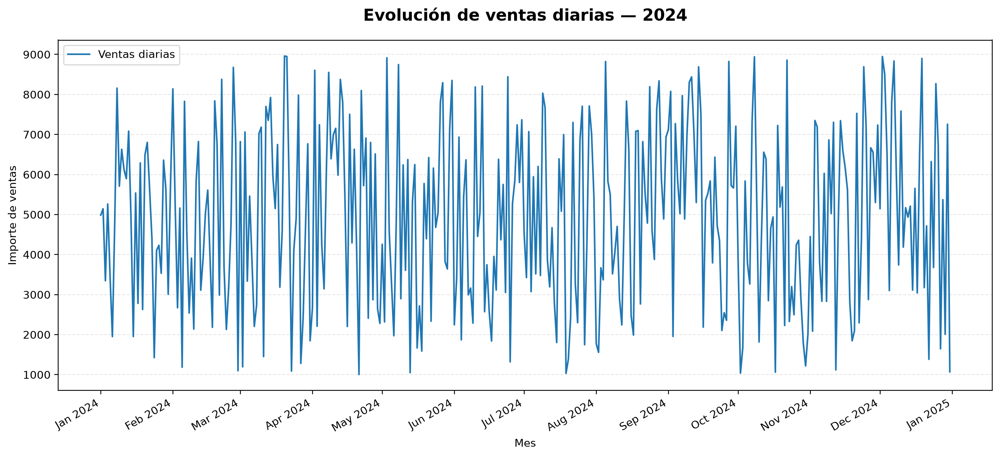

# Análisis de ventas con Python
## TP Gestion Colaborativa - Git, GitHub y Jira

## Integrantes
| Rol | Usuario | Responsabilidad |
|-----|---------|-----------------|
| P1 - Lider | Braian_Martinez_1 | Estructura del repositorio y documentacion |
| P2 - Desarrollador | Braian_Martinez_2 | Script de analisis y dataset |
| P3 - Revisor QA | Braian_Martinez_3 | Revision tecnica y documentacion |

## Escenario
Escenario B - Analisis de Ventas de una Pequeña Empresa
Analisis estadistico de un dataset de ventas comerciales del año 2024.

## Dataset
- Fuente: sales_sample_2024.csv
- Formato: CSV
- Registros: 366 registros diarios del año 2024
- Columnas: id, sales_date, sales_amount

## Estructura del Repositorio
- datos/sales_sample_2024.csv
- scripts/analisis_ventas.py
- scripts/revision_tecnica.txt
- resultados/grafico_ventas.png
- README.md
- .gitignore

## Instrucciones para ejecutar el script
1. Clonar el repositorio: git clone https://github.com/Bramart96/analisis-ventas-python.git
2. Instalar dependencias: `python -m pip install pandas matplotlib`
3. Desde la raíz del repositorio ejecutar: `python scripts/analisis_ventas.py`

**Nota:** la ejecución actual requiere acceso a internet porque el script obtiene el CSV desde una URL externa. También existe una copia del dataset en `datos/`.

## Resultados verificados (ejecución local)

| Indicador | Resultado |
| --- | ---: |
| Registros procesados | 366 |
| Total de ventas | 1.812.114 |
| Promedio diario | 4.951,13 |
| Venta máxima | 8.960 |
| Venta mínima | 1.003 |

Se comprobó la carga de datos, los cálculos con pandas, la agrupación temporal y la generación del gráfico en Matplotlib. Son valores del dataset de ejemplo, sin moneda especificada.

### Evidencia gráfica

**Alcance:** análisis exploratorio académico. El script aún depende de una URL externa para cargar el archivo y no tiene pruebas automatizadas documentadas.

## Trazabilidad
Proyecto gestionado con Jira. Cada commit referencia su issue correspondiente.
